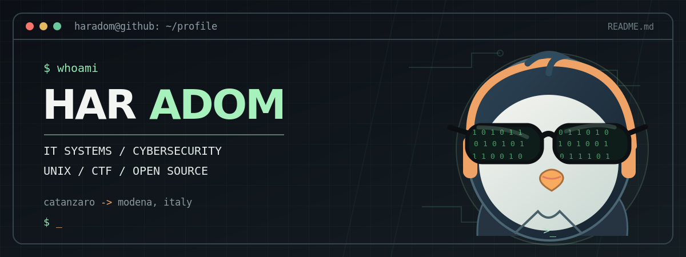

<!-- GitHub Profile README — repository name must be exactly: HarAdom -->

  

  
  
  

## 👨‍💻 About Me

- 🏛️ **IT Systems Assistant** at the **Italian Ministry of the Interior** — Prefettura di Modena.
- 🎓 **Computer Engineering student**, with a focus on information security.
- 🐧 Interested in **Unix/Linux, cybersecurity, CTFs, networking and open-source software**.
- 🛰️ Previously worked on **satellite-data-related activities**, supporting the European Space Agency (ESA).
- 📍 Born and raised in **Catanzaro**, now based in **Modena, Italy**.
- 💡 I like learning by building things, breaking them in controlled labs, and understanding how they work.

## 🚀 Projects & Community

| Project | Description |
| :--- | :--- |
| 🏠 **[Personal Homepage](https://haradom.github.io/)** | My personal corner of the web, with projects, notes and more. |
| 🦅 **[HackLab Catanzaro](https://hacklab.cz/)** | A community-oriented project for technology enthusiasts, hackers and curious minds. *Work in progress.* |
| 🔐 **[Code & Security Experiments](https://github.com/HarAdom?tab=repositories)** | Small tools, CTF-related experiments and things I build while learning. |

## 🧰 Tech Stack & Tools

*Things I work with, study or explore — not a list of certifications.*

**Languages & development**

**Systems & environments**

**Security & labs**

## 🌐 Find Me Online

  
  
  

---

<code>~ $ stay curious · keep learning · share knowledge</code>

<!-- Add LinkedIn, Signal, email or GPG links here only if you want them to be public. -->
